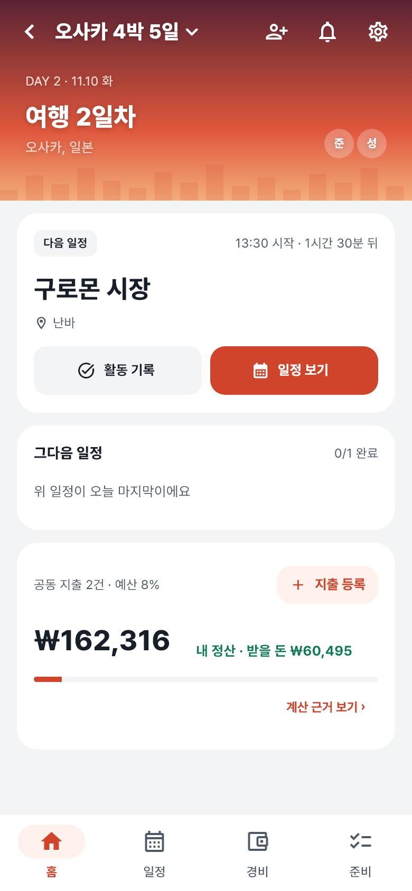
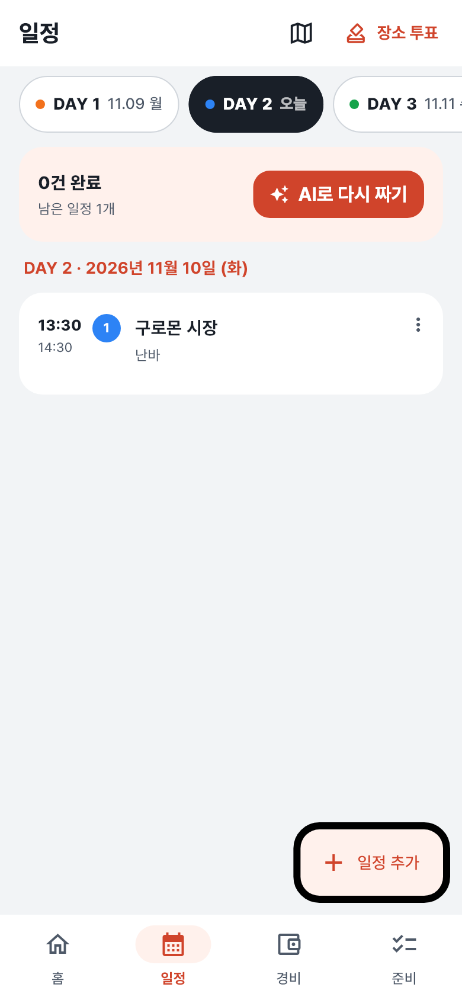
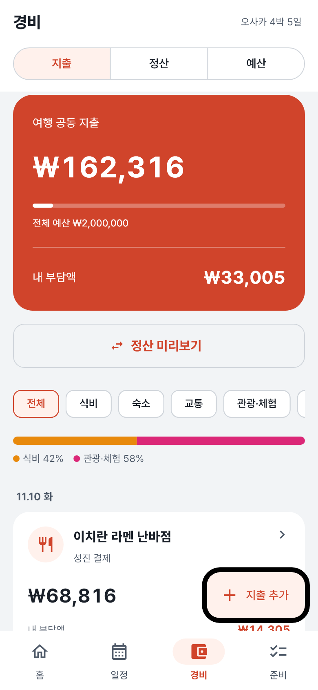
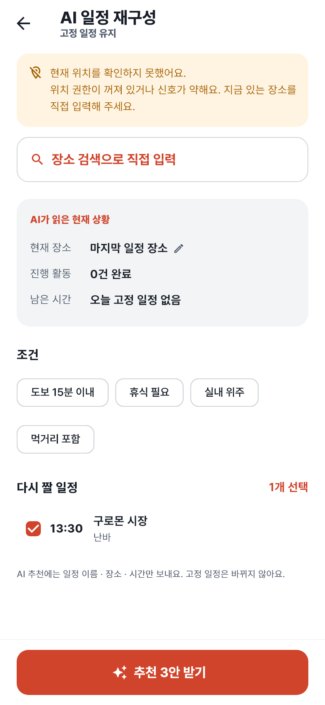
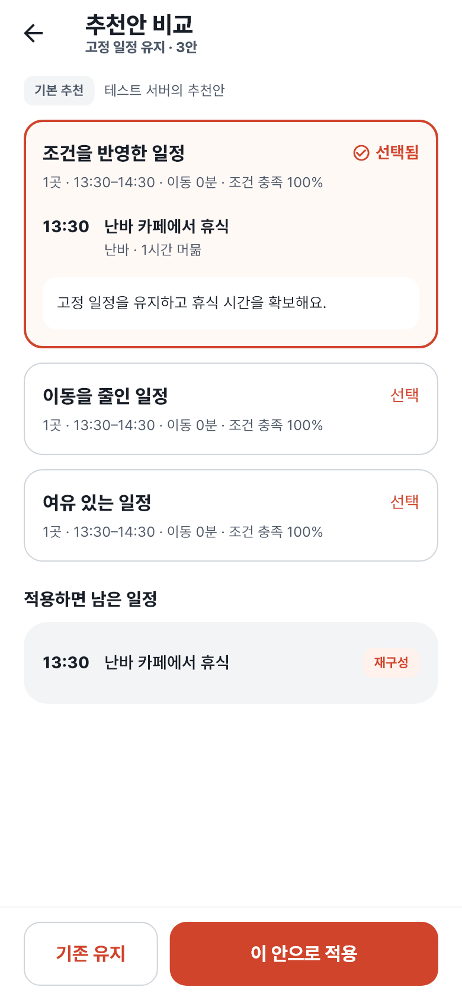
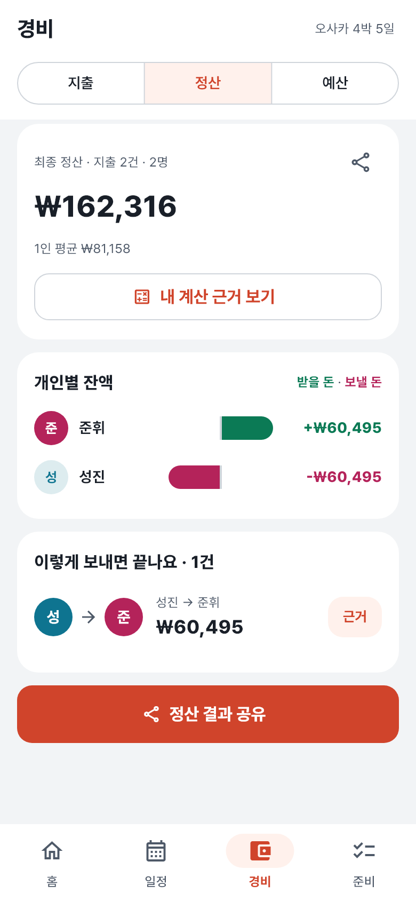

  
  <h1>Backpack</h1>
  
<strong>일정부터 정산까지, 함께 가는 여행</strong>

  
여행 준비 · 공동 일정 · 지출 기록 · 최종 정산을 한곳에서

  

    <a href="#앱-둘러보기">화면 보기</a> ·
    <a href="docs/features.md">기능 상세</a> ·
    <a href="docs/development.md">실행 가이드</a> ·
    <a href="docs/README.md">프로젝트 문서</a>
  

  
<code>Android · iOS</code> <code>Flutter</code> <code>Spring Boot</code>

---

## 함께 떠나는 여행을 더 가볍게

Backpack은 친구들과 떠나는 여행의 준비부터 마지막 정산까지 함께 관리하는 앱입니다.
메신저에 흩어진 일정, 따로 적어 둔 지출, 누가 얼마를 보내야 하는지 헷갈리는 계산을 하나의 여행 안에 모읍니다.

출발 전에는 준비할 일을 나누고, 여행 중에는 다음 일정과 함께 쓴 돈을 확인하고, 돌아온 뒤에는 각자의 정산 결과를 공유할 수 있습니다.

## Backpack으로 할 수 있는 일

| | 함께 관리하는 여행 |
| --- | --- |
| 🧳 **여행 준비** | 여행을 만들고 초대 코드로 멤버를 모아요. 공동 업무는 담당자를 정하고, 개인 준비물은 체크리스트로 챙겨요. |
| 🗓️ **일정과 장소** | 날짜별 일정과 예약 상태를 확인해요. 지도에서 장소와 동선을 보고, 함께 갈 곳은 투표로 정해요. |
| ✨ **AI 일정 재구성** | 일정이 늦어졌다면 남은 일정의 추천안을 비교하고 선택한 안을 적용해요. |
| 🧾 **영수증과 지출** | 영수증을 촬영해 지출 입력을 돕고, 함께 쓴 돈을 균등·항목별·개별 금액으로 나눠요. |
| 💱 **환율과 예산** | 현지 통화와 원화를 함께 관리하고, 예산 대비 지출과 1인 준비 금액을 확인해요. |
| 🤝 **마지막 정산** | 받을 돈과 보낼 돈, 계산 근거와 송금 경로를 확인하고 정산 결과를 공유해요. |

## 앱 둘러보기

실제 Flutter 화면을 캡처했습니다. 아래 여행·금액·AI 추천안은 **테스트 응답으로 구성한 예시 데이터**입니다.

<table>
  <tr>
    <th align="center">여행 홈</th>
    <th align="center">날짜별 일정</th>
    <th align="center">공동 경비</th>
  </tr>
  <tr>
    <td align="center"></td>
    <td align="center"></td>
    <td align="center"></td>
  </tr>
  <tr>
    <td align="center">다음 일정과 내 정산을 한눈에</td>
    <td align="center">하루의 흐름을 함께 확인</td>
    <td align="center">함께 쓴 돈과 예산을 한곳에</td>
  </tr>
  <tr>
    <th align="center">AI 일정 재구성</th>
    <th align="center">추천안 비교</th>
    <th align="center">최종 정산</th>
  </tr>
  <tr>
    <td align="center"></td>
    <td align="center"></td>
    <td align="center"></td>
  </tr>
  <tr>
    <td align="center">상황에 맞춰 남은 일정 다시 짜기</td>
    <td align="center">추천안을 비교하고 직접 선택</td>
    <td align="center">누가 누구에게 얼마를 보낼지 확인</td>
  </tr>
</table>

## 이렇게 사용해요

1. **여행 만들기** — 여행지와 기간을 정하고 초대 코드로 멤버를 모아요.
2. **함께 준비하기** — 일정과 장소를 정하고 준비할 일을 나눠요.
3. **여행 기록하기** — 활동과 지출을 기록하고, 필요하면 남은 일정을 조정해요.
4. **정산 마무리하기** — 각자의 부담액과 송금 경로를 확인하고 결과를 공유해요.

## 프로젝트 안내

Backpack은 **Flutter 모바일 앱과 Spring Boot API 서버**로 구성되어 있습니다.
로그인과 데이터 저장에는 API 서버가 필요하며, 지도·AI·OCR·푸시는 서비스 설정과 기기 환경에 따라 사용 조건이 다릅니다.
초대 코드로 가입한 멤버가 여행에 참여할 수 있으며, **비회원 게스트 인증은 아직 준비 중**입니다.

| 궁금한 내용 | 문서 |
| --- | --- |
| 앱 실행 · Android Studio 설정 · 빌드 · 오류 해결 | [개발 및 실행 가이드](docs/development.md) |
| 전체 기능과 사용 조건 | [기능 상세](docs/features.md) |
| 서버 실행과 환경변수 | [백엔드 가이드](backend/README.md) |
| API · 데이터 구조 | [API 명세](docs/api/README.md) · [ERD](docs/erd/README.md) |
| 디자인 · 개발 규칙 · 배포 | [프로젝트 문서 모음](docs/README.md) |
| 기능 통합 범위와 검증 기록 | [통합 및 검증](docs/integration.md) |
