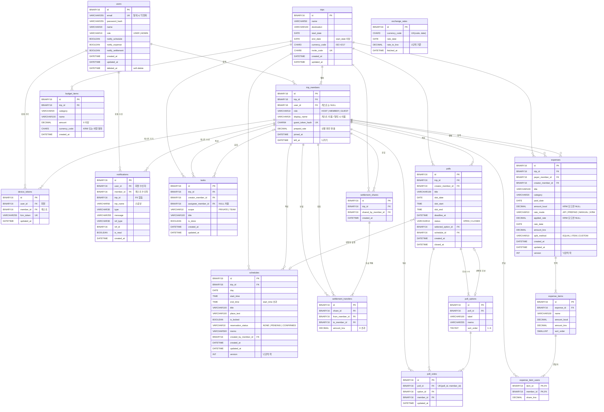

# ERD

기준: [`V1__init.sql`](../../backend/src/main/resources/db/migration/V1__init.sql) (MySQL 8.4)

- 모든 PK/FK는 UUID v7을 `BINARY(16)`으로 저장한다 (값은 앱의 `BaseEntity`가 만든다)
- 시각은 `DATETIME(6)`에 UTC로 저장한다
- 리프레시 토큰은 Redis에 있으므로 테이블이 없다

## 전체 관계도

`exchange_rates`는 다른 테이블과 FK 없이 `currency_code` + 날짜로만 조회한다.

## 테이블 요약

| 영역 | 테이블 | 설명 |
|---|---|---|
| 회원 | `users` | 회원. 탈퇴는 `deleted_at` (soft delete) |
| 여행 | `trips` | 여행. 통화 1개, 초대 코드 8자리 |
| | `trip_members` | 여행 참여자. 회원(`user_id`) 또는 게스트(`guest_token_hash`) |
| 준비 | `tasks` | 준비 업무. `PRIVATE`(나만) / `TEAM`(공용) |
| 알림 | `device_tokens` | FCM 토큰. 회원/게스트 중 하나 |
| | `notifications` | 알림함. 여행이 삭제돼도 남는다 |
| 일정 | `schedules` | 하루 단위 시간표. 자정을 넘는 일정 불가 |
| 투표 | `polls` / `poll_options` / `poll_votes` | 일정 슬롯에 넣을 장소 투표. 후보 1~6개, 1인 1표 |
| 예산 | `exchange_rates` | 일자별 환율 캐시 (통화 1단위 → KRW) |
| | `budget_items` | 카테고리별 예산 |
| 지출 | `expenses` / `expense_items` / `expense_item_users` | 지출 → 항목 → 항목별 분담자·분담액 |
| 정산 | `settlement_shares` / `settlement_transfers` | 정산 결과를 공유한 시점의 송금 목록 스냅샷 |

## 코드값

| 컬럼 | 값 |
|---|---|
| `users.role` | `USER`, `ADMIN` |
| `trip_members.role` | `HOST`, `MEMBER`, `GUEST` |
| `tasks.scope` | `PRIVATE`, `TEAM` |
| `schedules.reservation_status` | `NONE`, `PENDING`, `CONFIRMED` |
| `polls.status` | `OPEN`, `CLOSED` |
| `expenses.category`, `budget_items.category` | `FOOD`, `LODGING`, `TRANSPORT`, `ACTIVITY`, `SHOPPING`, `ETC` |
| `expenses.rate_mode` | `API`(환율 API), `PREPAID`(본인 선불 환율), `MANUAL`(직접 입력), `KRW`(원화 직접) |
| `expenses.split_method` | `EQUAL`(N분의 1), `ITEM`(항목별), `CUSTOM`(금액 직접) |
| `notifications.type` | `SCHEDULE_CHANGED`, `EXPENSE_ADDED`, `SETTLEMENT_SHARED`, `TRIP_DELETED` |
| `notifications.ref_type` | `SCHEDULE`, `EXPENSE`, `SETTLEMENT_SHARE` |

## 삭제 정책

- 여행을 지우면 하위 데이터(멤버·업무·일정·투표·예산·지출·정산)가 전부 CASCADE로 지워진다
- 멤버는 지우지 않는다. 나가기는 `left_at` 기록, 다시 들어오면 `NULL`로 되돌린다
- 회원 탈퇴는 `deleted_at` 기록 + 이메일 익명화(앱 처리)
- `notifications.trip_id`는 FK가 없어서 여행 삭제 알림이 남는다

## 앱에서 검증할 것 (DB 제약 없음)

- `device_tokens`, `notifications`: `user_id` / `member_id` 중 정확히 하나만 값이 있어야 한다
- `settlement_transfers`: `from_member_id <> to_member_id`
- `poll_votes.option_id`, `polls.selected_option_id`가 같은 투표의 후보인지
